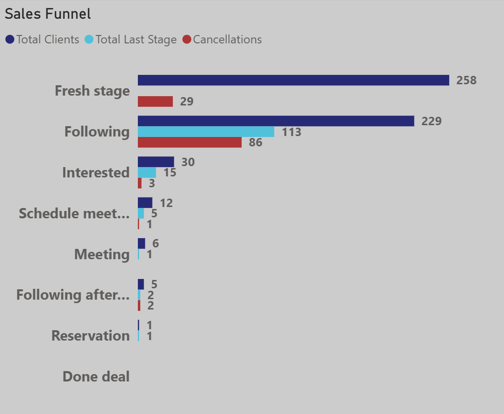
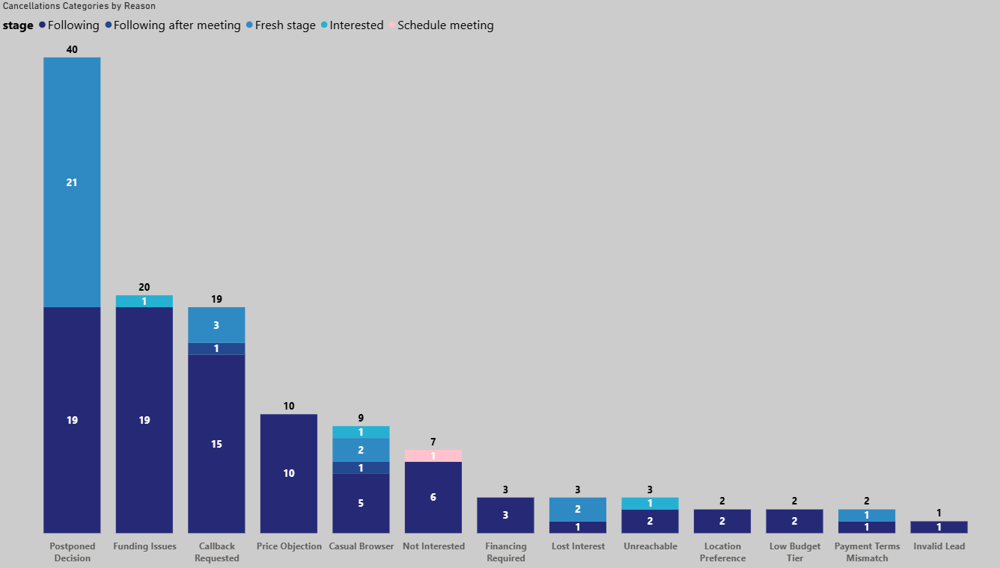
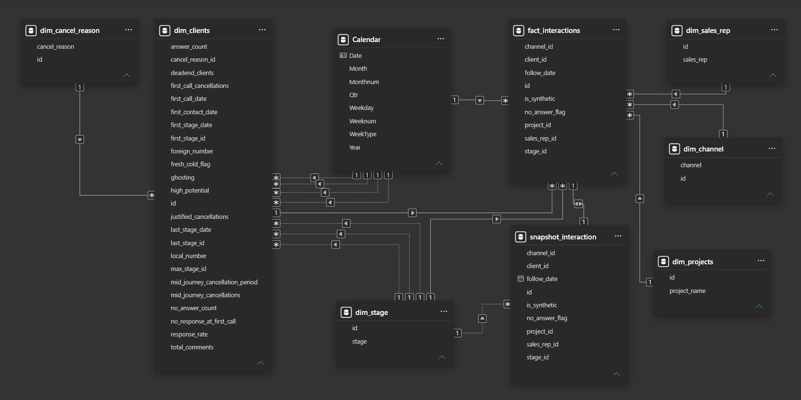
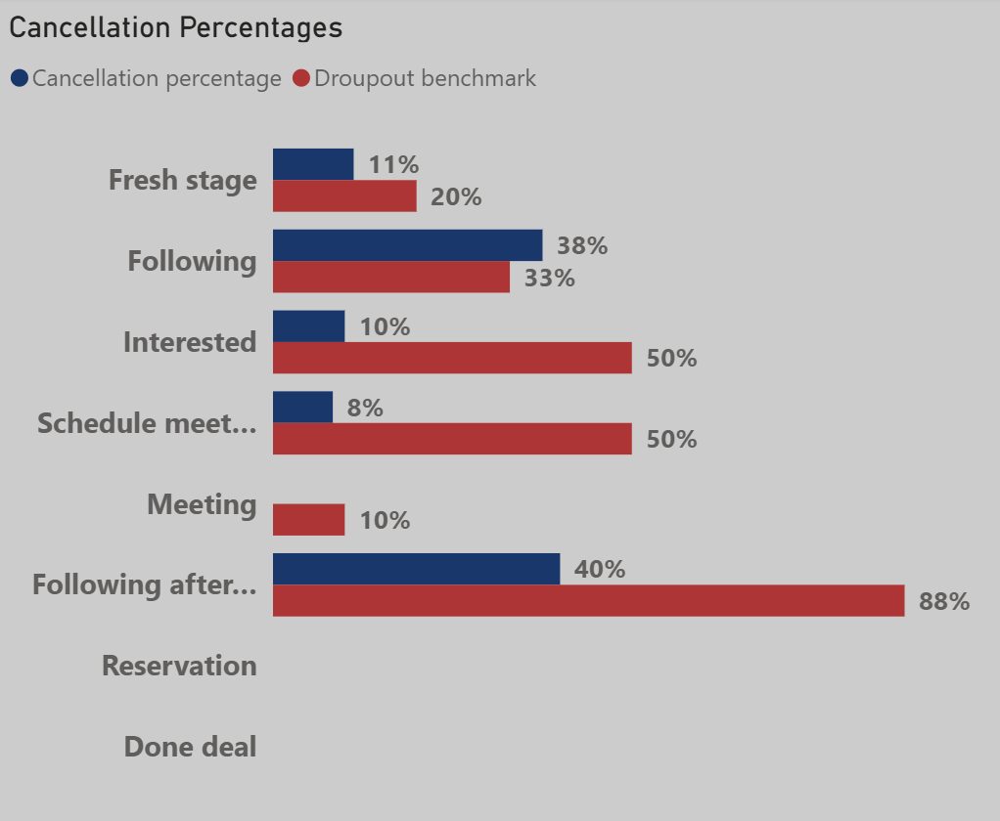
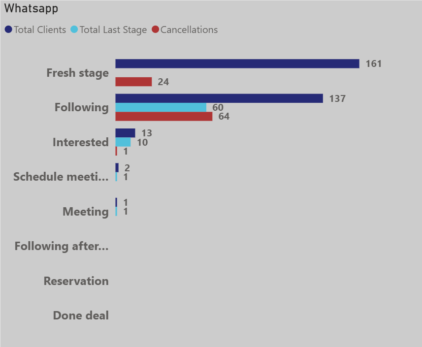
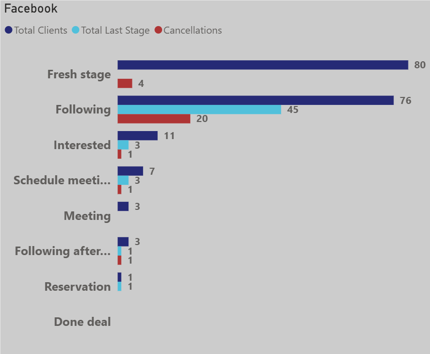
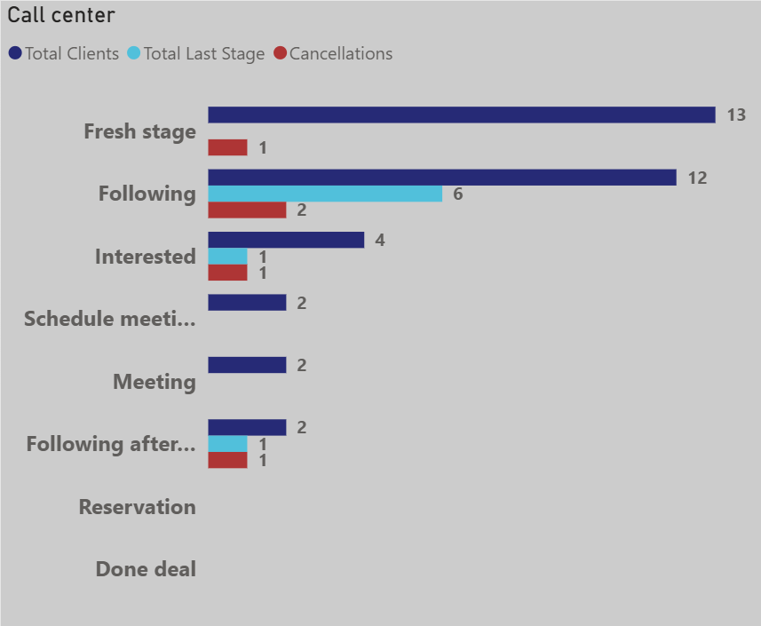
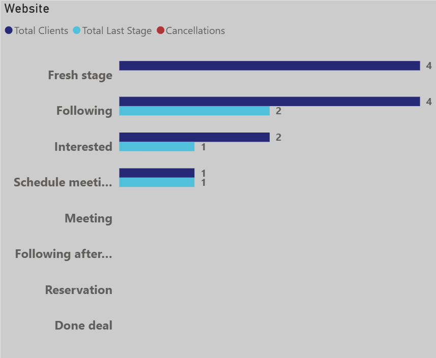
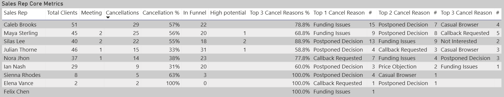

<h1 align="center">Sales Funnel and Cancel Reasons Analysis</h1>

<table align="center">
<tr>
<td width="900">

- How is the Sales performing, Why do clients cancel and How can we reduce avoidable Dropouts?
- 2026/04/24
- powerbi_report_.xlsx

</td>
</tr>
</table>

<h2 align="center">Background</h2>

<table align="center">
<tr>
<td width="900">

- The `Vista Real Estate Group` is a newly founded Real Estate Marketing Agency that directly contracts with property developers to market and sell their Real Estate in Aswan governorate.

- Since its inception six month ago building and levering a client data base of over 10,000 successfully selling 91 Commercial and Residential properties in 14 projects including Malls, Condo Buildings, and Apartment Complexes for 7 developers in many locations within the city.

- After contracting a project with a developer for selling specific number of units the company stars a campaign in multiple channels `Fresh clients` and look for previous clients in the data base who would be interested in this project `Cold Clients` then start 30 days process of contacting and communicating values to the leads.

- Depending on the progress of the sales funnel and success of the promotion the company may continue with the same strategy until the end of the 30 days or re-strategize their process any point within the same period.

- Reporting to the Operations, an Investigation of the Sales funnel performance for the `South Valley` project for the last 27 days which is a concern for since the entire team was not able to close any deals yet on the project, and where only able to secure one reservation.

- The core Metric to track the progress and stage to stage drop outs is the "Cancellations" count. which also includes:
  - No response: Evaluating the number of clients that never responded to the communications attempts of the sales reps.
  - First call cancellation: Evaluating the first call cancellation reason and weekday.

</td>
</tr>
</table>

<h2 align="center">Executive Summary</h2>

<table align="center">
<tr valign="top">
<td align="center" width="368">

</td>
<td align="center" width="532">

</td>
</tr>
</table>

<table align="center">
<tr>
<td width="900">

- Sales Funnel:
	- The funnel started with 294 leads, 36 were unreachable, and 29 cancelled on the first call.
	- The second stage `Following` kicked off with 229 clients then lost 86 to cancellation for various reasons.
	- Dropout percentages were under the threshold for all the stages except the `Following` which exceeded it's threshold by 4.6% losing 33% of it's clients.
	- 6 clients reached the `Meeting` stage 2 cancelled and 4 still in the funnel.
	- The Max stage the funnel reached is the `Reservation` stage with only One client.
	- about 50% of the clients still in the funnel in various stages.

- Cancel Reasons:
	- 65% of the cancellations happened for the cancellation reasons of`Postponed Decision`, `Funding Issues`, and `Callback Request`.
	- the cancellation reasons with the least number of clients are  `Location Preference`, `Low Budget Tier`, `Payment Term Mismatch`, and `Invalid Lead` amounting to 6% of the total cancellations.
	- the two Cancellations after the `Meeting` stage happened for the reasons of `Callback Request` and `Casual Browsing`

- Recommendations  

	- Always provide contact info in the promotions.
	- Review the Sales Rep's Interactions and Re-evaluate the Sales Procedure.
	- Refer to the Project Developer to provide Discounts, Flexible payment plans, and Funding options.
	- Use calls from the top performers in the team to enhance the Under Training Team's performance ASAP.
	- Support and Incentivize the Sales Reps to close a deal with the in funnel clients ASAP.

</td>
</tr>
</table>

<h2 align="center">Dataset Structure and ERD (Entity relationship diagram)</h2>

<table align="center">
<tr>
<td width="900">

- the `powerbi_report_.xlsx` consists of `1633` row in the `fat_interactions` for `294` client representing all the interaction attempts made with clients for the `South Valley` project.

> the source file for the dashboard `powerbi_report_.xlsx` is the cleaned output of a raw Excel file from the one of my client's CRM after being processed and cleaned by the ETL python Pipeline made for him.

> Kept both the original CRM raw excel file and ETL pipeline confidential based on client's demand.

</td>
</tr>
</table>

<table align="center">
<tr>
<td width="900">

</td>
</tr>
</table>

<h2 align="center">Insights Deep Dive</h2>

<h3 align="center">Sales Funnel</h3>

<table align="center">
<tr valign="top">
<td align="center" width="450">

</td>
<td align="center" width="450">

</td>
</tr>
</table>

<table align="center">
<tr>
<td width="900">

- Leads Generation:
  - Since the start of the promotion of the `South Valley` project in 4/24/2026 until 5/21/2026 there are 294 leads generated through four channels.
  - There are also 36 clients across various stages whom are unreachable until now, there are also 29 lost to `First Call Cancellation` coming up to 11% which is 9% less than the acceptable threshold of 20%.

- Funnel Status:
  - The sales funnel starts with 258 clients in the first stage `Fresh Stage` in which 29 clients where lost to `First Call Cancellation`.
  - Aside the  lost to `First Call Cancellation` unreachable clients all the clients have been contacted by the sales rep team and passed the `Fresh stage`.
  - the `Following` stage has the highest number of Dropouts with 86 clients which represents 71% of the total cancellations.
  - The funnel ends with one client in the `Reservation` stage, which is less than the expected 2 to 3 clients in the `Done deal` or at least in the `Reservation` stage given 294 leads at the end of the 30 days which is ony 4 days away.

- Dropouts:
  - the cancellation percentages throughout the funnel is well within the acceptable limits for most of the stages.
  - the `Following` stage is the only stage with cancellation percentage more than the acceptable threshold of 33% exceeded by 4.6%.
  - the `Following after meeting` stage showing the highest percentage of Dropouts with 40% with 2 clients in reserve whom considered high potential as such late stage in the funnel.

- last stage (clients reserve) per stage
  - the funnel have a Decent client reserve indicated by the `Following` stage having 113 clients as their last stage which representing 49% of all the clients who went through this stage.
  - the same goes for the rest of the stages where `Interested` have 15 of 30 clients, `Schedule meeting` have 5 of 12, `Meeting` have 1 of 6, `Following after meeting` have 2 of 5, and `Reservation` have one client.

</td>
</tr>
</table>

<h3 align="center">Cancel Reasons</h3>

<table align="center">
<tr>
<td width="900">

- Low potential clients (before the `Meeting` stage):
  - the top 3 cancel reasons `Postponed Decision`, `Funding Issues`, and `Callback Request` amount to over 65% of the total cancellations mostly occurring in the first two stages `Fresh stage` and the `Following` stage.
  - the cancellations of `Location Preference`, `Low Budget Tier`, `Payment Term Mismatch`, and `Invalid Lead` have the least cancellations with combined percentage of 6% of the total cancellations which suggests a effective customer targeting and promotion.
  
- High potential clients (`Meeting` stage and above):
  - given that the client committed through out the funnel, and attended the meeting that reflects having the purchasing power, genuine interest, and financial decision independence.
  - Only two cancellations happened one for `Callback Request` and the other for `Casual Browsing` that reflects minimal terms miss-match with the clients expectation of the actual real estate unit, contract terms and conditions, or the payment plan.

</td>
</tr>
</table>

<h3 align="center">Channels</h3>

<table align="center">
<tr>
<td width="900">

- Promotion procedure.
  - the company relay only on promotions through facebook and the leads through this channel are the ones that the moderators acquired their phone number after commenting on a campaign post, then Sales Rep team contact them.
  - whatsapp leads comes from the facebook promotion after whatsapp button on the post.
  - call center leads (not cold calling for this project) call after seeing a the promotion on facebook and get the company phone number from the page contact info.
  - As for the website it's only provided on the page contact info.

</td>
</tr>
</table>

<table align="center">
<tr valign="top">
<td align="center" width="450">

</td>
<td align="center" width="450">

</td>
</tr>
<tr valign="top">
<td align="center" width="450">

</td>
<td align="center" width="450">

</td>
</tr>
</table>

<table align="center">
<tr valign="top">
<td width="450">

`Whatsapp`

- has the highest number of prospects with 161 clients, despite that almost all of the clients are low potential except only one client at the meeting stage.

</td>
<td width="450">

`Facebook`

- is the best channel in terms of clients progress and the only channel with a top stage (`Reservation`/`Done deal`).
- it comes second for the number of prospects with 80 clients, and it has the highest number of `Meeting`s with 3 clients which is half of the entire sales funnel.

</td>
</tr>
<tr valign="top">
<td width="450">

`Call Center`

- Although it ranks the third with 13 prospects it is extremely far from the `Facebook` and `Whatsapp` channels.
- and despite the small number of prospects it managed to deliver two clients to the `Meeting` stage and keep 1 in the `Following after meeting` stage.

</td>
<td width="450">

`Website`

- Although it is 8 days old it generated 4 prospects, and until now although it has no cancellations it didn't deliver any clients to the meeting stage.

</td>
</tr>
</table>

<table align="center">
<tr>
<td width="900">

- Given the number of leads, the number of clients went through the `Meeting` stage, and the over all progress of clients through the funnel for each channel the `Call Center` ranks first, followed by `Facebook`, then `Whatsapp`, and `Website` comes last.

- the previous ranking demonstrates the willingness of a client to invest in our projects given a specific channel.

</td>
</tr>
</table>

<h3 align="center">Sales Reps</h3>

<table align="center">
<tr>
<td width="900">

#### Cancellation

- sorting by the cancellations percentage the team can be divided into two groups plus the new team members who still under training.
  - Group 1 (over 50%): `Caleb Brooks`, `Maya Sterling`, and `Silas Lee`.
  - Group 2 (under 40%): `Julian Thorne`, `Nora Jhon`, and `Ian Nash`.
  - Under Training: `Sienna Rhodes`, `Elena Vance` and `Felix Chen`.

- Group 1 mostly has the highest number of clients and the highest  cancellations percentage, while Group 2 has the lowest number of clients But with much less Cancellation Percentages.

- `Julian Thorne` have 46 clients comparable with the Group 1 despite a cancellation percentage will within the Group 2's.

#### Sales funnel

- `Maya Sterling` and  `Silas Lee` secured 2 meetings each with 45 and 40 clients at cancellations percentage of 56% and 55% respectively.
- where as `Julian Thorne` and `Nora Jhon` secured one meeting each with 46 and 37 clients at cancellation percentages of 33% and 38% receptively.
- `Ian Nash` and `Caleb Brooks` secured no meetings, thats despite `Celeb Brook` having the highest number of clients of 51 clients and `Ian Nash` having the least cancellation percentage of 31% .

- `Julian Thorne` have the highest clients preserve `In Funnel` of 31 clients where as the rest of the team have between 18 and 23 clients in the funnel.

#### Cancel Reasons

- the Top 1 and 2 cancellation reasons are mainly represented in `Funding Issues`, `Postponed Decision`, and `Callback Requested` for all the Reps.

- the Top 3 Cancel reasons percentage for `Julian Thorne` is the lowest for the entire team by a small margin but when compared by the rest of the Group one members he is 10% les from the nearest Member.

</td>
</tr>
</table>

<h2 align="center">Recommendations</h2>

<table align="center">
<tr>
<td width="900">

### Channel

- provide contact info in every post to make it easy for the client to contact the company and make the contact decision on the spot and invest more in the website.
  - Many campaign posts messing the phone number nor and especially the website.
  - call center is the second highest channel in the number of clients who went through the `Meeting` stage with 2 clients which is third of the number who went through this stage in the entire funnel while starting with only 13 leads show the highest lead to meeting conversion ratio.
  - the website has only 4 leads a very low number but with no cancellation so far
  - the website channel also does not seem very attractive to clients or well known demonstrated by it's earliest client being only 8 days old.

- Strategically enable whatsapp message button at the beginning of the the project promotion or sales target is not met.
  - This feature massively increase the cost of the campaign for each lead it generate.
  - although whatsapp brought 161 leads of which is the highest but only one client in the `Meeting` stage making it the worst performing active channel.

- Continue carrying out Campaigns through Facebook.
  - facebook has the highest number of clients who went through the `Meeting` stage with 3 clients which is half of the clients of the entire funnel for that stage, it also brought 80 leads which is the second hightest.
  - the rest of the channel are mainly driven by the facebook campaigns.

### Sales Reps

- Review the Sales Rep's adherence to the "BENT" procedure and if it's acceptable then improve the procedure it self.
  - sales reps with relatively high number of clients tend to have high Cancellation Percentages than the Reps with lower number of clients.

- Cherish `Julian Thorne`'s performance, Review his interactions with the clients who have the highest progress in the sales tunnel, and Apply the Lessons learned to the rest of the team to bring up the whole team's performance.
  - `Julian Thorne` showing A high degree of efficiency bringing A high number of clients, having low cancellations percentage, and his top 3 cancellation reasons percentages are the lowest compared to the rest of the team which reflects a wider variety of cancellation reasons steering more away from the finance related related cancellation reasons which shows his ability to link the product value to the client's needs.  

- Use calls from the top performers in the team to enhance the Under Training Team's performance ASAP.
  - `Julian Thorne`, `Maya Sterling`, and `Silas Lee` relatively have the least cancellations while bringing 5 of 6 clients to the `Meeting` stage.
  - the new team `Sienna Rhodes`, `Elena Vance` and `Felix Chen` combined contribute to the entire funnel by 10 clients only so far.

- Support and Device a performance enhancement plan for both `Caleb Brooks`, and `Ian Nash`.
  - Although `Caleb Brooks` brought the highest number of clients to the sales funnel and have the highest cancellation percentage outside of the Under training team.
  - `Ian Nash` brought the least number of clients to the funnel outside of Under Training team.
  - both of them couldn't bring any clients to the `Meeting` stage so far.

- Incentivize the sales reps to capitalize on their clients reserve to Close a deal ASAP.
  - Most of the team still have a relatively high number of clients still in the funnel.

### Sales Funnel

- Leads Generation:
  - continue targeting the same client segments.
    - lost only 11% of the leads to `First Call Cancellation` which is less than the 20% threshold by 9%.
- Funnel Status:
  - come up with discounts ,easier payment plan, and financing options and announce it to the in funnel clients.
    - The funnel ends with one client in the `Reservation` stage, which is less than the expected 2 to 3 clients in the `Done deal` or at least in the `Reservation` stage given 294 leads at the end of the 30 days which is ony 4 days away.
- Dropouts:
  - Inform the high potential dropout clients by the new discounts, easier payment plan, and financing options (If possible) to win them back.
    - the `Following after meeting` stage showing the highest percentage of Dropouts with 40% with 2 clients in reserve whom considered high potential as such late stage in the funnel
- last stage (clients reserve) per stage  
  - Capitalize on the Reserve clients to boost the sales back.
    - most of the stages have around 50% Clients reserve in various stages.

### Cancel Reasons

- Continue Targeting the same Clients segment on the Marketing campaigns.
  - All the price and location reasons `Price Objection`, `Invalid Lead`, `Payment Terms Mismatch`, `Location Preference` amount to 17 clients which is only 14% of the total cancellation.

- Provide payment plans and suggest the Reservation with the clients that Have the financial Ability to pay but they can't commit write away.
  - the top three reasons of cancellations are `Postponed Decision`, `Funding Issues`, and `Call Back Requested` reflect a lack of available liquidity on the side of clients and represent 57% of the total cancellations.

- Employ sales tactics like showing rarity and urgency with the clients in the `Meeting` stage.
  - there are 2 clients in the `Following after meeting` plus one in the `Meeting` stages and the clients who cancelled after going through the `Meeting` stage cancelled with reasons of `Call Back Requested` and `Casual Browsing`.

</td>
</tr>
</table>
